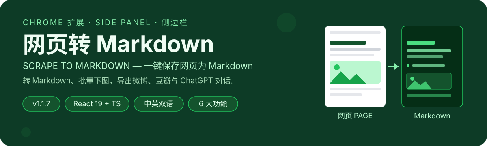
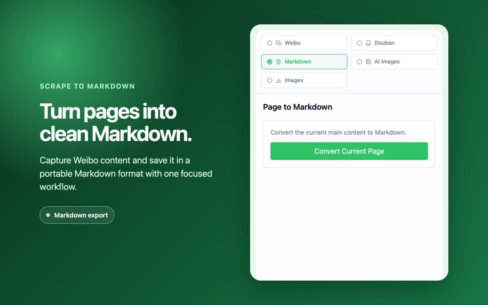
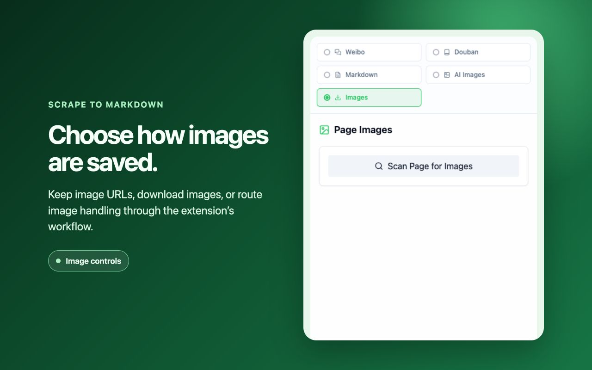

<p align="right"><a href="README.md">中文</a></p>

<p align="center">
  
</p>

<p align="center">
  <a href="https://github.com/holynova/scrape-to-markdown.chrome/releases">⬇ Latest Release</a>
  ·
  <a href="https://github.com/holynova/scrape-to-markdown.chrome">GitHub Repository</a>
</p>

Scrape to Markdown is a Chrome side-panel extension (Manifest V3, v1.1.7): click the toolbar icon and a panel opens on the right — convert the current page to clean Markdown, batch-download AI-generated and webpage images, and export Weibo posts, Douban collections, and ChatGPT conversations. UI in English and Chinese.

## Screenshots

<p align="center">
  
  
</p>

> Both screenshots reuse the Chrome Web Store listing assets in the repository (`release/chrome-web-store/screenshots/`, 1280×800).

## Features

| Feature | Description |
|------|------|
| Page to Markdown | Readability extracts the article body + Turndown converts it to Markdown — one click for the current page |
| AI Image Saver | Downloads original images from Gemini MyStuff and ChatGPT Images, packed into a ZIP; optional max-image limit, task summary, and expandable progress logs |
| Page Images | Scans the current page for all images, filters by dimension, downloads in bulk |
| Weibo scraper | Collects posts from a Weibo profile page, with filtering, exports JSON / Markdown |
| Douban export | Exports Douban Books / Movies collections in four categories — 「看过」 (watched/read) and 「想看」 (want to watch/read) (book-collect, book-wish, movie-collect, movie-wish) — with sequential tasks and resume-after-navigation |
| ChatGPT conversation exporter | Exports ChatGPT conversations, optionally including images and attachments, downloaded as a ZIP (new in v1.1.7) |
| Smart initial tab | Opens the most relevant panel for the current page automatically, falling back to the Images panel |
| Build timestamp | The panel footer shows the build time, so you can confirm Chrome loaded the latest build |

## Install

The extension is not published on the Chrome Web Store (store assets are in `release/chrome-web-store/` — screenshots, promo images, and a submission checklist), so it must be loaded manually:

1. Download the latest ZIP from [Releases](https://github.com/holynova/scrape-to-markdown.chrome/releases) and unzip it
2. Open `chrome://extensions/` and enable Developer mode
3. Click "Load unpacked" and select the unzipped folder
4. Click the toolbar icon to open the side panel

Build from source:

```bash
git clone https://github.com/holynova/scrape-to-markdown.chrome.git
cd scrape-to-markdown.chrome
npm install
npm run build     # produces dist/; load that directory in chrome://extensions/
```

Development: `npm run dev` (Vite + crxjs hot reload); `npm run lint` for checks.

## Notes

- ChatGPT image downloads use the browser's current login session and the ChatGPT image-library API; if the API's shape changes, the extraction logic needs to follow.
- Gemini image downloads rewrite image URLs to request full-resolution originals.
- Already-compressed images are not re-compressed when packing ZIPs, so packing is faster.
- Permissions: `sidePanel`, `activeTab`, `scripting`, `storage`, `tabs`, `downloads`; host permissions include `weibo.com` and all URLs (content scripts must inject on any page); privacy policy in `docs/privacy/`.

## Tech

- React 19 + TypeScript 5.9 + Vite 7 + `@crxjs/vite-plugin` (MV3 build) + Tailwind CSS 3.
- Content extraction: `@mozilla/readability` + `turndown`; image packing: `jszip`; plus `dompurify` and `lucide-react`.

```
manifest.json           MV3 manifest: sidePanel, permissions, all-URL content scripts
sidepanel.html          Side-panel entry
src/sidepanel/App.tsx   All side panels (~77KB: images / Markdown / Weibo / Douban / ChatGPT)
src/sidepanel/i18n.ts   English/Chinese copy
src/content/            Content scripts: generic injection, ChatGPT export, Weibo, Douban
src/background/         Service Worker: image downloads
src/pages/intro/        Intro page (project homepage)
docs/assets/            Documentation screenshots
release/                Store listing assets: screenshots, promo images, privacy policy, checklist
```
