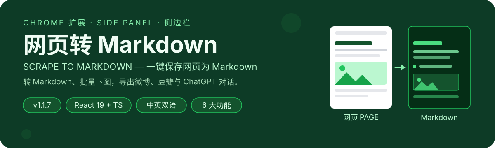
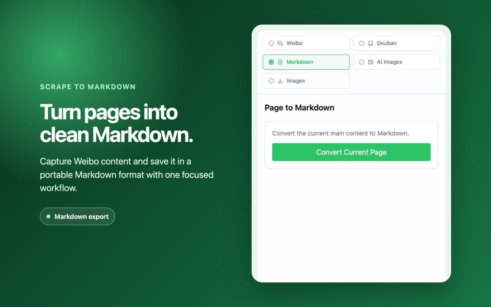
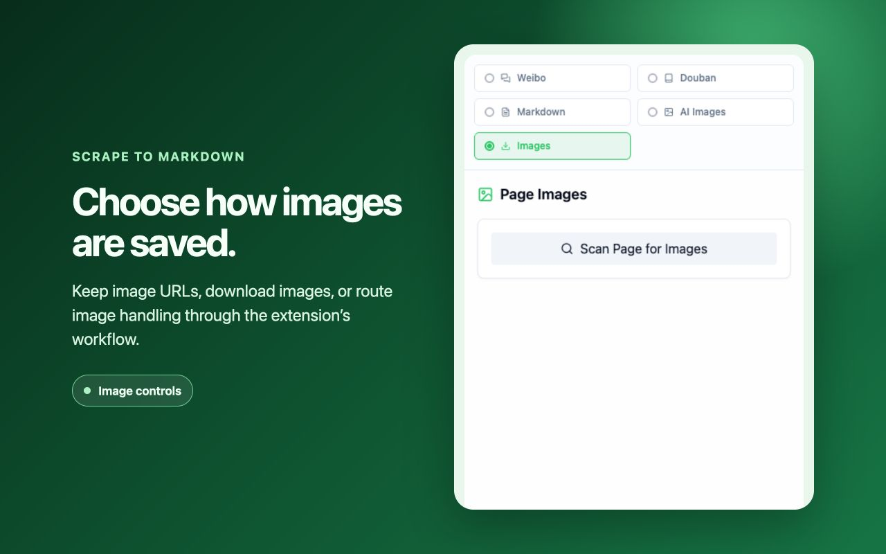

<p align="center">
  
</p>

<p align="center">
  <a href="https://xiaosang.cc/scrape-to-markdown-chrome/">▶ 项目主页 Project Page</a>
  ·
  <a href="https://github.com/holynova/scrape-to-markdown.chrome/releases">⬇ 最新 Release</a>
  ·
  <a href="https://github.com/holynova/scrape-to-markdown.chrome">GitHub 仓库</a>
</p>

Scrape to Markdown 是一个 Chrome 侧边栏扩展（Manifest V3，v1.1.7）：点工具栏图标，在浏览器右侧打开面板——把当前网页转成干净的 Markdown、批量下载 AI 生图与网页图片、导出微博帖子、豆瓣书影收藏与 ChatGPT 对话。界面中英双语。

Scrape to Markdown is a Chrome side-panel extension (Manifest V3, v1.1.7): click the toolbar icon and a panel opens on the right — convert the current page to clean Markdown, batch-download AI-generated and webpage images, and export Weibo posts, Douban collections, and ChatGPT conversations. UI in English and Chinese.

## 截图 / Screenshots

<p align="center">
  
  
</p>

> 两张图均复用仓库内 Chrome 应用店上架素材（`release/chrome-web-store/screenshots/`，1280×800）。

## 功能 / Features

| 功能 | 说明 |
|------|------|
| 网页转 Markdown | Readability 提取正文 + Turndown 转 Markdown，一键转换当前页 |
| AI 图片保存 | 下载 Gemini MyStuff 与 ChatGPT Images 的原图，打包成 ZIP；可设数量上限，带任务摘要与可展开的进度日志 |
| 页面图片 | 扫描当前网页全部图片，按尺寸过滤，批量下载 |
| 微博采集 | 采集微博个人主页帖子，支持过滤，导出 JSON / Markdown |
| 豆瓣导出 | 导出豆瓣读书 / 电影的「看过 / 想看」四类收藏（book-collect、book-wish、movie-collect、movie-wish），支持顺序任务、断点续爬 |
| ChatGPT 对话导出 | 导出 ChatGPT 对话，可选包含图片与附件，打包 ZIP 下载（v1.1.7 新增） |
| 智能初始标签 | 按当前页面自动打开最相关的面板，否则默认图片面板 |
| 构建时间戳 | 面板页脚显示构建时间，便于确认 Chrome 加载的是最新构建 |

## 安装 / Install

扩展未上架 Chrome 应用店（上架材料在 `release/chrome-web-store/`，含截图、宣传图与提交清单），需手动加载：

1. 在 [Releases](https://github.com/holynova/scrape-to-markdown.chrome/releases) 下载最新 ZIP 并解压
2. 打开 `chrome://extensions/`，开启「开发者模式」
3. 点击「加载已解压的扩展程序」，选择解压后的文件夹
4. 点工具栏图标打开侧边栏

从源码构建：

```bash
git clone https://github.com/holynova/scrape-to-markdown.chrome.git
cd scrape-to-markdown.chrome
npm install
npm run build     # 生成 dist/，在 chrome://extensions/ 加载该目录
```

开发：`npm run dev`（Vite + crxjs 热更新）；`npm run lint` 做检查。

## 注意事项 / Notes

- ChatGPT 图片下载使用当前浏览器登录会话与 ChatGPT 图片库 API；API 形态变化时提取逻辑需要跟进。
- Gemini 图片下载会转换图片 URL 以请求全分辨率原图。
- ZIP 打包时已压缩的图片不再二次压缩，打包更快。
- 权限：`sidePanel`、`activeTab`、`scripting`、`storage`、`tabs`、`downloads`，主机权限含 `weibo.com` 与全部网址（内容脚本需在任意页面注入）；隐私政策见 `docs/privacy/`。

## 技术 / Tech

- React 19 + TypeScript 5.9 + Vite 7 + `@crxjs/vite-plugin`（MV3 构建）+ Tailwind CSS 3。
- 内容提取：`@mozilla/readability` + `turndown`；图片打包：`jszip`；另有 `dompurify` 与 `lucide-react`。

```
manifest.json           MV3 清单：sidePanel、权限、全部网址内容脚本
sidepanel.html          侧边栏入口
src/sidepanel/App.tsx   侧边栏全部面板（约 77KB：图片 / Markdown / 微博 / 豆瓣 / ChatGPT）
src/sidepanel/i18n.ts   中英双语文案
src/content/            内容脚本：通用注入、ChatGPT 导出、微博、豆瓣
src/background/         Service Worker：图片下载
src/pages/intro/        介绍页（项目主页）
docs/assets/            文档截图
release/                应用店上架材料：截图、宣传图、隐私政策、提交清单
```

## English

**Scrape to Markdown** is a Chrome side-panel extension (Manifest V3, v1.1.7) for saving web content as Markdown and exporting social reading data.

- **Page to Markdown**: Readability extracts the article body, Turndown converts it to clean Markdown — one click for the current page.
- **AI Image Saver**: downloads original images from Gemini MyStuff and ChatGPT Images into a ZIP, with an optional max-image limit, task summary, and expandable progress logs.
- **Page Images**: scans the current page for images, filters by dimension, downloads in bulk.
- **Weibo scraper**: collects profile posts with filtering, exports JSON / Markdown.
- **Douban export**: exports book/movie collections and wishes (collect + wish × books + movies) with sequential tasks and resume-after-navigation.
- **ChatGPT conversation exporter** (new in 1.1.7): export conversations with optional images and attachments, downloaded as a ZIP.
- **Smart initial tab** picks the most relevant panel for the active page (falls back to Images); a **build timestamp** in the footer confirms Chrome loaded the latest build; UI in English and Chinese with a persistent language switcher.
- **Install**: download the latest Release ZIP, enable Developer mode at `chrome://extensions/`, Load unpacked. Or build from source: `npm install && npm run build`, then load `dist/`. Not published on the Chrome Web Store (store assets are in `release/chrome-web-store/`).
- **Tech**: React 19, TypeScript 5.9, Vite 7, `@crxjs/vite-plugin`, Tailwind CSS 3, Readability, Turndown, JSZip, DOMPurify.

## 许可 / License

本仓库未声明许可证。
